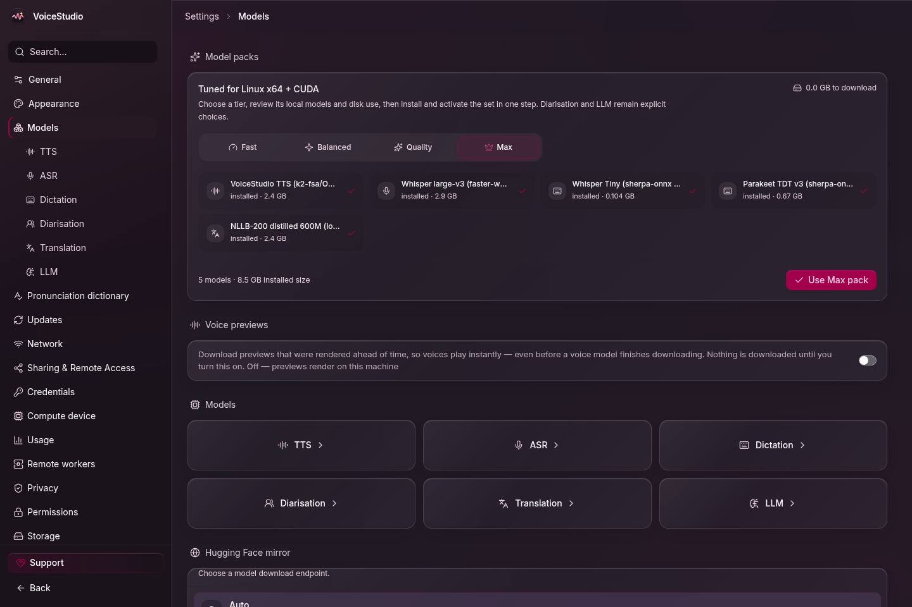

> **[中文化] VoiceStudio**
>
> 此项目是 [debpalash/VoiceStudio](https://github.com/debpalash/VoiceStudio) 的中文翻译版本。
> - 原项目 Stars: 90387
> - 主语言: Python
> - 许可证: AGPL-3.0
> - 翻译日期: 2026-10-27
> - 原始 README: [README_en.md](README_en.md)
>
> 说明：下方 README 正文为**原项目文档的中文翻译**，力求忠于原文；本页顶部的「中文快速上手」为**面向中文用户的补充导读**（非原文内容），目的是让你不用读完整篇 README 就能先把项目跑起来。
>
> 如有翻译不准确之处，欢迎提 Issue 或 PR。

---


## 🚀 中文快速上手（补充导读，非原文）

### 这是什么 / 解决什么问题

VoiceStudio 是一个本地优先的语音工作室，支持语音克隆、语音设计、视频配音、听写、转写和有声书制作，覆盖 646 种语言。它默认使用 k2-fsa/OmniVoice 引擎，也允许切换其他引擎。痛点在于：把原本分散的语音合成、配音、转写等工作流集中到一个桌面应用里，并且本地工作流跑在自己的硬件上，远程服务是可选的。

### 快速上手（最短路径）

1. macOS / Linux 执行一键安装（安装最新 Electron 版本）：

   ```sh
   curl -fsSL https://voicestudio.sh/install | sh
   ```

   Windows 在 PowerShell 中执行：

   ```powershell
   irm https://voicestudio.sh/install.ps1 | iex
   ```

2. 如果 `voicestudio.sh/install` 无法访问或返回 404，改用仓库内的脚本：

   ```bash
   curl -fsSL https://raw.githubusercontent.com/debpalash/VoiceStudio/main/scripts/install.sh | sh
   ```

3. 也可以直接从 [Releases](https://github.com/debpalash/VoiceStudio/releases/latest) 下载对应平台安装包（macOS `.dmg`、Windows `.exe`、Linux `.AppImage` / `.deb`、Android `.apk`、iPhone `.ipa`），Linux 还可用 `sudo snap install voicestudio`。

4. 打开应用后进入 **Voice cloning**，选择一个声音或添加干净的参考录音，输入文本并生成；提示时安装所需模型。

### 环境要求

- **操作系统**：macOS、Windows、Linux（含 Nix / NixOS、Docker 安装方式）；Android 10+ 与 iOS 17+ 为 Preview 支持。
- **硬件**：
  - NVIDIA GPU（Windows / Linux）：CUDA 加速。
  - Apple Silicon（M1–M5）：Metal（MPS）加速。
  - AMD Radeon / 部分 Ryzen AI（Windows）：默认走 CPU，可选 Windows ROCm 配置。
  - 无独立显卡：可完全在 CPU 上运行，但更慢；安装会装小型 CPU 版 PyTorch，约需 5 GB 空闲磁盘。
  - Intel Mac：仅应用 UI，需连接远程后端。
  - Windows on ARM：实验性，仅 CPU。
- **依赖**：发布版下载需要 curl 和 SHA-256 工具；`--main` 构建方式需要 Git、Node.js 22+、Bun、Rust/Cargo 及平台构建工具。
- **Python 版本**：`pyproject.toml` 要求 Python >= 3.11。
- **国内网络提示**：安装脚本与发布包均从 `voicestudio.sh` 和 GitHub 拉取，国内网络可能需要自备加速或镜像手段（原文未提供具体镜像源）。

### 常见坑与注意事项

- 硬件差异明显：不同引擎的硬件需求不同，无独显时只能走 CPU 且更慢；Intel Mac 无法本地跑后端，只能连远程后端。
- 模型需单独下载：首次生成时会提示安装所需模型，属于额外下载步骤。
- 安装脚本有前置依赖：发布版下载依赖 curl 与 SHA-256 工具；用 `--main` 从源码构建还需 Git、Node.js 22+、Bun、Rust/Cargo 和平台构建工具。
- 许可证为 AGPL-3.0：闭源商用需另行联系获取商业许可（原文提到可联系 hi@voicestudio.sh）。

---


---

<div align="center">
  
  <h1>VoiceStudio</h1>
  <p>
    <a href="https://trendshift.io/repositories/28176?utm_source=repository-badge&amp;utm_medium=badge&amp;utm_campaign=badge-repository-28176" target="_blank" rel="noopener noreferrer"></a>
  </p>
  <p><strong>开源语音克隆、语音设计、视频配音、听写、转录与有声书制作，支持 646 种语言。</strong></p>
  <p>
    <a href="https://voicestudio.sh/?utm_source=github&utm_medium=readme&utm_campaign=project">网站</a> ·
    <a href="https://github.com/debpalash/VoiceStudio/releases/latest">下载</a> ·
    <a href="#get-started">快速开始</a> ·
    <a href="#documentation">文档</a> ·
    <a href="https://discord.gg/bzQavDfVV9">Discord</a> ·
    <a href="docs/readme/README_CN.md">简体中文</a> ·
    <a href="docs/readme/README_JA.md">日本語</a> ·
    <a href="docs/readme/README_KO.md">한국어</a> ·
    <a href="docs/readme/README_RU.md">Русский</a>
  </p>
  <p>
    <a href="https://github.com/debpalash/VoiceStudio/actions/workflows/ci.yml"></a>
    <a href="https://github.com/debpalash/VoiceStudio/releases/latest"></a>
    <a href="LICENSE"></a>
    <a href="https://supermetry.com"></a>
  </p>
</div>


## 你的声音，你的工作流。

| 创作 | 制作 | 连接 |
| :--- | :--- | :--- |
| 克隆声音或自行设计 | 为视频配上定时语音 | 面向 Agent 的本地 API 与 MCP |
| 用悬浮组件听写 | 故事、有声书与批量任务 | 可复用配方与监视文件夹 |

从 **VoiceStudio** 开始（默认，由 k2-fsa/OmniVoice 驱动），或选择其他引擎。[功能与引擎目录](docs/feature-catalog.md)。

本地工作流在你的硬件上运行。远程服务可选；使用分析需征得同意。

<details>
<summary><strong>探索各工作区</strong> · 克隆、配音、设计与模型</summary>

<table>
  <tr>
    <td></td>
    <td></td>
  </tr>
  <tr><td align="center">语音克隆</td><td align="center">视频配音</td></tr>
  <tr>
    <td></td>
    <td></td>
  </tr>
  <tr><td align="center">语音设计</td><td align="center">本地模型</td></tr>
</table>


</details>

OmniVoice GGUF 源码构建可选择在 Windows 和 Linux 上使用 Vulkan；
构建要求、CPU 回退与设备覆盖见[原生引擎指南](docs/engines/omnivoice-gguf.md#optional-vulkan-acceleration)。

## 快速开始

### 一键安装（macOS / Linux）

```sh
# 最新 Electron 发布版本
curl -fsSL https://voicestudio.sh/install | sh

# 指定已发布的 Electron 版本（替换 X.Y.Z）
curl -fsSL https://voicestudio.sh/install | sh -s -- --version X.Y.Z

# 构建当前 main 并安装桌面应用
curl -fsSL https://voicestudio.sh/install | sh -s -- --main

# 卸载应用，保留数据
curl -fsSL https://voicestudio.sh/install | sh -s -- --uninstall
```

Windows 上，在 PowerShell 中运行 `irm https://voicestudio.sh/install.ps1 | iex`。

若 `voicestudio.sh/install` 无法访问或返回 404，可直接从仓库运行同一脚本，或克隆后运行 `scripts/install.sh`：

```bash
curl -fsSL https://raw.githubusercontent.com/debpalash/VoiceStudio/main/scripts/install.sh | sh
```

发布版本下载需要 curl 和 SHA-256 工具。`--main` 需要 Git、
Node.js 22+、Bun、Rust/Cargo 及平台构建工具；见
[安装器前提与行为](docs/install/script.md)。
安装器会保留你的设置、项目和模型。旧版本
必须包含 Electron 包；它绝不会回退到已归档的 Tauri 构建。

或从 [Releases](https://github.com/debpalash/VoiceStudio/releases/latest) 下载（macOS `.dmg`、Windows `.exe`、Linux `.AppImage` 或 `.deb`、Android `.apk`、iPhone `.ipa`；Linux 上也可 `sudo snap install voicestudio`），并按平台指南操作：

**[macOS](docs/install/macos.md) · [Windows](docs/install/windows.md) · [Linux](docs/install/linux.md) · [Nix / NixOS](docs/install/nix.md) · [Docker](docs/install/docker.md) · [Android 与 iPhone](docs/mobile.md#install)**

| 硬件 | 支持 |
|---|---|
| NVIDIA GPU（Windows / Linux） | CUDA 加速 |
| AMD Radeon / 受支持的 Ryzen AI（Windows） | 默认 CPU；针对 AMD 的 Windows 11 硬件矩阵，可选择启用 [Windows ROCm 配置](docs/install/windows-rocm.md)。配置会区分包修复与主机故障；请先手动安装 VC++ 运行时。可选引擎有各自限制；Vulkan 引擎保留自己的运行时。 |
| Apple Silicon（M1–M5） | Metal（MPS）加速 |
| AMD GPU | 可选的原生 CosyVoice GGUF 在社区运行时以 Vulkan 构建时可用 Vulkan；已在 RX 6700 XT 上验证（[配置](docs/engines/cosyvoice-gguf.md)） |
| 无独立 GPU（Intel/AMD 集成显卡、较旧 PC） | 可在 CPU 上完全使用，速度较慢；配置会安装小型 CPU 版 PyTorch（约需 5 GB 可用磁盘） |
| Windows on ARM（Snapdragon X 等） | **实验性**，待验证：原生 ARM64 应用，x64 Python 后端在模拟下运行，仅 CPU |
| Intel Mac | 仅应用 UI；连接远程后端（[原因](docs/install/macos.md)） |
| Android 手机（Android 10+） | **预览**：模型在手机上运行，下载后离线可用（[安装](docs/mobile.md#install)） |
| iPhone 与 iPad（iOS 17+） | **预览**：模型在设备上运行；用你的 Apple ID 侧载 IPA（[安装](docs/mobile.md#install)） |

打开 **语音克隆**，选择声音或添加干净的参考录音，输入文本并生成。按提示安装所需模型。硬件需求因引擎而异；见[性能](docs/performance.md)。

### 通过提示词安装

粘贴到你的编码 Agent（Claude Code、Codex、Cursor 等）：

```text
Install the VoiceStudio Electron app on this device and verify it works, following
https://github.com/debpalash/VoiceStudio/blob/main/docs/install/agent.md
```

[Agent 指南](docs/install/agent.md)涵盖硬件检测、复用现有
数据、下载模型前询问，以及测试生成。支持 skills 的 Agent
也可运行 `npx skills add debpalash/VoiceStudio`。

<details>
<summary><strong>从源码运行 Electron 预览</strong></summary>

```bash
git clone https://github.com/debpalash/VoiceStudio.git
cd VoiceStudio
bun install
bun run setup:api  # prepare Python dependencies before starting Electron
bun run dev
```

前提条件与后端配置见 [Electron 配置](electron/README.md)。

使用 `bun run smoke-test` 构建并启动隔离的打包 Electron 应用。
添加 `-- --install` 可进行联网的托管运行时安装检查。

</details>

> **Electron 是唯一的桌面应用和 Web UI。** 0.5.3 版是最后一个 Tauri 发布版本。现有 Tauri 用户必须[单独安装 Electron](docs/electron-migration.md)。已停用的 Tauri 外壳和旧版 UI 入口已移除。

## 文档

| 需求 | 从这里开始 |
|---|---|
| 配置帮助 | [故障排查](docs/install/troubleshooting.md) · [模型下载](docs/downloading-models.md) |
| 分步指南 | [为多角色视频配音](docs/dubbing/multi-speaker-guide.md) · [富有表现力的语音](docs/expressive-speech.md) · [导出配音](docs/dubbing/export.md) |
| 模型与音频质量 | [引擎指南](docs/engines/README.md) · [whisper.cpp ASR](docs/engines/whisper-cpp.md) · [基准测试](docs/benchmarks.md) |
| 集成 | [本地 API](docs/speech-platform.md) · [MCP](docs/mcp.md) · [示例](examples/README.md) |
| 手机应用（预览，离线运行） | [iOS 与 Android](docs/mobile.md) |
| 开发 | [贡献](.github/CONTRIBUTING.md)（首次 PR 的 [CLA 签署指南](.github/CONTRIBUTING.md#contribution-licensing)） · [Electron](electron/README.md) · [更新日志](CHANGELOG.md) |

Agent skills：`npx skills add debpalash/VoiceStudio` — 音频工作流选择 **voicestudio**，仓库维护选择 **voicestudio-maintainer**。

## 团队

### 核心团队

<table>
<tr>
<td align="center" width="200"><a href="https://github.com/debpalash"></a><br><b>Palash Debnath</b><br><sub>创建者与核心团队</sub><br><sub><a href="https://palash.dev">palash.dev</a> · <a href="https://github.com/debpalash">GitHub</a> · <a href="https://x.com/idebpalash">X</a></sub></td>
<td align="center" width="200"><a href="https://github.com/velixio"></a><br><b>Shimul Debnath</b><br><sub>核心团队</sub><br><sub><a href="https://shimul.me">shimul.me</a> · <a href="https://github.com/velixio">GitHub</a> · <a href="https://x.com/shimuldn">X</a></sub></td>
</tr>
</table>

### 贡献者

<a href="https://github.com/kevin9327"></a> <a href="https://github.com/jaketame"></a> <a href="https://github.com/psiberfunk"></a> <a href="https://github.com/rudycelekli"></a> <a href="https://github.com/paoloantinori"></a> <a href="https://github.com/Chang-Jin-Lee"></a> <a href="https://github.com/swadhinbiswas"></a> <a href="https://github.com/BichengWang"></a> <a href="https://github.com/nirmalchatur"></a> <a href="https://github.com/Shivendra-Coherent"></a> <a href="https://github.com/marreiradigital"></a> <a href="https://github.com/nvtoan0201-swe"></a>

感谢所有提交代码、报告、翻译和想法的人。[查看所有贡献者](https://github.com/debpalash/VoiceStudio/graphs/contributors) · [参与贡献](.github/CONTRIBUTING.md)

## 赞助

赞助用于支持维护者时间、开发工具、发布基础设施和测试硬件；它购买的是认可，而非功能。

[GitHub Sponsors](https://github.com/sponsors/debpalash) · [Ko-fi](https://ko-fi.com/debpalash) · [PayPal](https://paypal.me/palashCoder) · [档位与认可](SPONSORS.md) · [申请认可](https://github.com/debpalash/VoiceStudio/issues/new?template=sponsor.yml)

## 许可与负责任使用

[AGPL-3.0](LICENSE) 覆盖本应用，包括按其条件进行的商业使用。模型权重、分词器、声音及生成输出的条件另行规定；付费应用许可不授予这些权利。仅在有许可的情况下克隆声音。模型管理器现在会显示来自[共享清单](docs/licensing/model-inventory.md)的带版本模型来源声明、证据链接和未解决的审查缺口。其可选的[已审查文件预览](docs/licensing/model-review-workflow.md)不会对普通下载强制执行，也不证明商业许可。见[许可详情](LICENSE-NOTICE.md)。