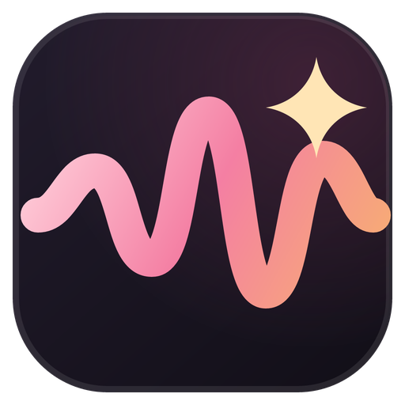

  
  <h1>赞助 VoiceStudio</h1>
  
<b>让这个开源的 ElevenLabs 替代品保持免费、本地运行并持续更新。</b>

  

---

## 为什么要赞助？

VoiceStudio 免费、完全本地运行，采用 AGPL-3.0 许可。它没有付费版、账户或云服务，因此没有经常性收入。赞助用于支持维护者的时间、开发工具、发布基础设施、签名证书和测试硬件。

赞助不会改变软件或模型的许可条款，不保证特定功能，也不能购买商业支持或商业许可。

---

## 赞助档位

GitHub Sponsors 是结账渠道；其档位名称和价格以下表为准。档位代表**认可与沟通**，而非功能或优先级。更高档位包含其下所有档位的权益。

| 档位 | 每月 | 你将获得 |
|------|--------:|--------------|
| **支持者** | $5+ | 资助开发。可选择在下方支持者名单中列出姓名。 |
| **社区赞助者** | $25 | 在 README 和本文件中列出你的姓名及链接。 |
| **开发赞助者** | $100 | 在 README 和本文件中展示小尺寸 Logo，并每季度收到一份书面开发进展（仅为摘要，不构成交付承诺）。 |
| **公司赞助者** | $500 | 在[项目网站](https://voicestudio.sh)上展示 Logo 和链接。 |
| **战略赞助者** | $1,000 | 每季度一次 30 分钟反馈通话。欢迎提供反馈；但反馈不决定路线图。 |

相同档位也以机器可读格式发布在 [`funding.json`](funding.json)（[funding.json](https://fundingjson.org) 格式）中；请保持两者一致。

认可仅展示在目前已有的渠道上：本文件、README 和网站。新渠道上线后，现有赞助者将自动纳入。

### 认可机制

- **生效时间：** 在你的付款和素材验证通过后五个工作日内。
- **月度赞助者：** 认可持续至你已付费的周期结束。
- **年度安排：** 起止日期以书面约定为准。
- **一次性捐赠：** 仅表示感谢，不提供永久展示位。
- **匿名支持**始终欢迎；只有你主动要求时才会列出。
- 任何内容发布前，付款均会私下验证。

### 不包含在赞助范围内

以下为独立安排，各有条款，需私下协商：

- **商业许可 / Pro** 有独立的条款和结账渠道。赞助不能购买许可。
- **演讲、工作坊和专题广告** 单独确定范围，包括时间、差旅和频率。

现有赞助者保留其最初购买的权益。

---

## 如何成为赞助者

**1. 付款。** 支持 VoiceStudio 无需填写表单：

- **GitHub Sponsors（月度或一次性，推荐）：** [github.com/sponsors/debpalash](https://github.com/sponsors/debpalash)
- **Ko-fi（定期或一次性）：** [ko-fi.com/debpalash](https://ko-fi.com/debpalash)
- **PayPal（一次性）：** [paypal.me/palashCoder](https://paypal.me/palashCoder)

**2. 申请认可（可选）。** 如需展示列表或 Logo，请提交[赞助咨询](https://github.com/debpalash/VoiceStudio/issues/new?template=sponsor.yml)，注明要展示的公开名称、链接和 Logo。Issue 是公开的，切勿在其中发布付款凭证或私人联系方式。

**3. 私密事务。** 收据、发票、年度或定制安排，以及任何你不想公开的内容，请发送至 [partner@voicestudio.sh](mailto:partner@voicestudio.sh)。也可在 [Discord](https://discord.gg/bzQavDfVV9) 的 `#dev` 频道咨询。

咨询不等于确认赞助：付款验证通过后，档位才算确认。

---

## Logo 与素材规范

为了让你的 Logo 在各处（GitHub 上的 README 和网站）都清晰锐利，请提供：

- **格式：** **优先 SVG**（可无损缩放）；否则提供 **2 倍分辨率 PNG**。
- **背景：** **透明**——不要带白色/黑色底框。
- **对比度：** 提供在**浅色和深色**背景下均清晰可读的版本，或分别提供浅色模式和深色模式文件（GitHub 和应用均支持两种主题渲染）。
- **尺寸：** 在**约 40px 高**时清晰可读；文字标识宽度控制在**约 480px 以内**。横版/文字标识形状最适合 README 行。
- **文件大小：** SVG 控制在约 50 KB 以内，PNG 控制在约 100 KB 以内。
- **链接目标：** 你希望 Logo 指向的目标 URL（通常是你的主页）。

**Logo 的添加方式：**

- **最简单：** 在[赞助咨询](https://github.com/debpalash/VoiceStudio/issues/new?template=sponsor.yml)中附上素材和链接——由维护者放置。
- **或提交 PR：** 将素材添加到 `docs/sponsors/` 下，并在本文件对应章节添加条目。

赞助即表示你确认有权使用所提交的 Logo，并授权 VoiceStudio 在上述场景中展示。我们不会对 Logo 做缩放以外的修改，并会在收到请求后及时移除。

---

## 当前赞助者

VoiceStudio 目前还没有列出任何赞助者——**你可以成为第一个。**

### 战略与公司赞助者

_待定。_

### 开发赞助者

_待定。_

### 社区赞助者

_待定。_

### 支持者

_待定。_

<!-- 赞助者验证通过后，将其添加到上方对应章节：
     - Logo 档位（$100+）：  
     - 姓名档位：          - [Name / handle](https://link)  -->

---

## 不是付费墙

VoiceStudio 的每一项功能现在和将来都**免费**，并**以 [AGPL-3.0](LICENSE) 开源**。赞助者**不会**获得私有构建、受限功能、许可例外或功能优先权。VoiceStudio 坚持本地优先，零花费即可完整使用。

---

感谢你让本地优先的语音 AI 保持活力与免费。❤️ 
有疑问？<a href="https://github.com/debpalash/VoiceStudio/issues/new?template=sponsor.yml">提交咨询</a> · <a href="mailto:partner@voicestudio.sh">partner@voicestudio.sh</a> · <a href="https://discord.gg/bzQavDfVV9">Discord</a>

